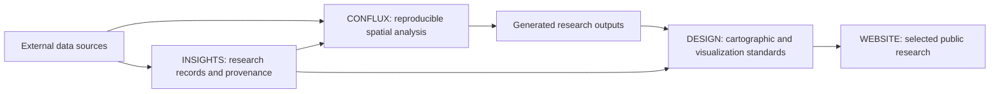

# System context

## Purpose

LAGUNE is a Spatial Intelligence & Research platform for producing reproducible spatial analysis and communicating research with clear sources, methods, and visual standards. It is a modular monorepo, not a single deployable service.

## Modules and boundaries

| Module | Responsibility | Does not own |
| --- | --- | --- |
| **CONFLUX** | Reusable spatial analysis and computation, exposed through a lightweight Python package. | Research curation, cartographic identity, or public-site delivery. |
| **INSIGHTS** | Structured records of research questions, methods, data sources, outputs, and provenance. | Bulk datasets or executable analysis infrastructure. |
| **DESIGN** | Brand identity, design tokens, cartographic standards, and visualization standards. | Research claims or data processing. |
| **WEBSITE** | Static, public-facing presentation of selected research. | Data storage, analysis execution, authentication, or backend services. |

## Conceptual flow



The diagram describes responsibilities and information flow, not a runtime pipeline. Module-specific interfaces and formats should be documented when introduced in their implementation stage.

## Initial constraints

- Keep the repository modular and understandable without requiring a deployed service.
- Keep large datasets and generated outputs outside Git.
- Keep CONFLUX lightweight; add GIS dependencies only for a documented use case and supported installation path.
- Use documented provenance and methods to connect research records to sources and outputs.
- Keep the initial website static. No backend, database, authentication, or AI interface is in scope.
- Do not build an autonomous AI agent runtime as part of the foundation.

## Planned repository areas

```text
docs/architecture/      Architecture documentation and accepted decisions
packages/conflux/       CONFLUX Python package (Stage B)
insights/               INSIGHTS metadata and research records (Stage B)
design/                 DESIGN standards and tokens (Stage B)
website/                Static public portfolio (Stage C)
```
